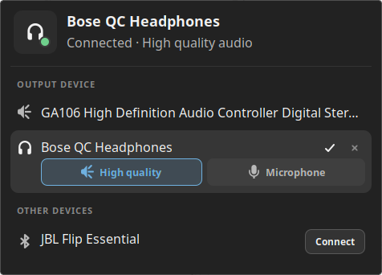
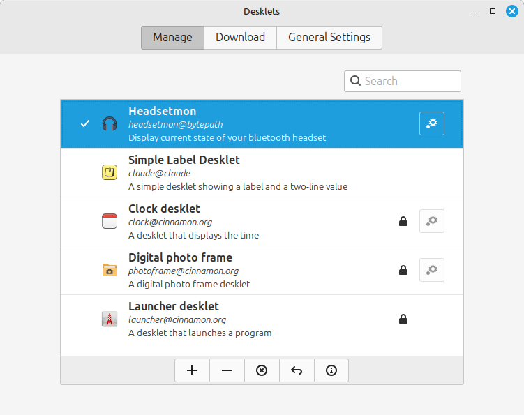

# Headsetmon Desklet

This Cinnamon desklet was created to ease some of the frustration with Linux Mint audio device UI.

### Features

* Easily view the currently selected audio output device
* Switch between audio output devices
* Switch between high-quality output and headset mode for bluetooth headsets.
* Connect and disconnect bluetooth audio devices

## Installation

* First download and install [paeventmon](https://github.com/alexspurling/pulse-audio-event-monitor)
* Place the `paeventmon` binary in your path e.g. in `~/.local/bin`
* Download the desklet zip package from the [releases page](https://github.com/alexspurling/headsetmon/releases).
* Extract the zip to `~/.local/share/cinnamon/desklets/`
* A directory will be created called `headsetmon@bytepath`
* Right-click your desktop and select `Desklets`
* Headsetmon should now be available in the list - click + to add it to your desktop.

